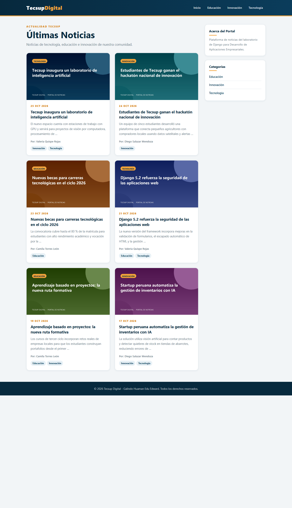
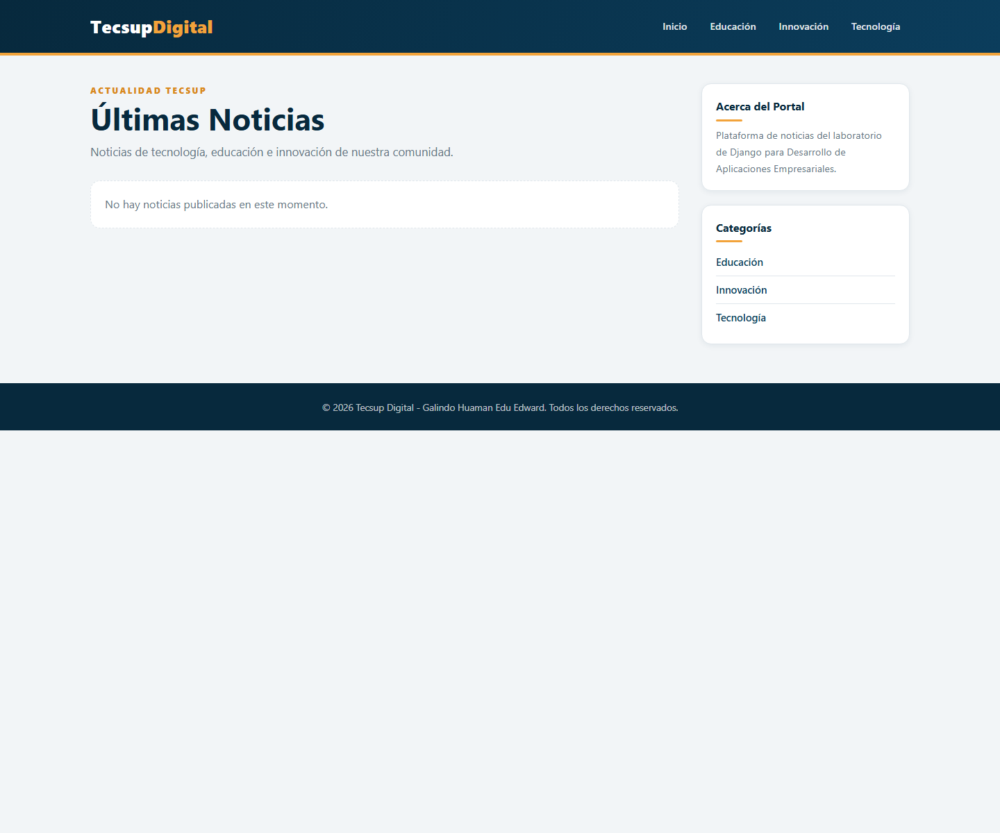
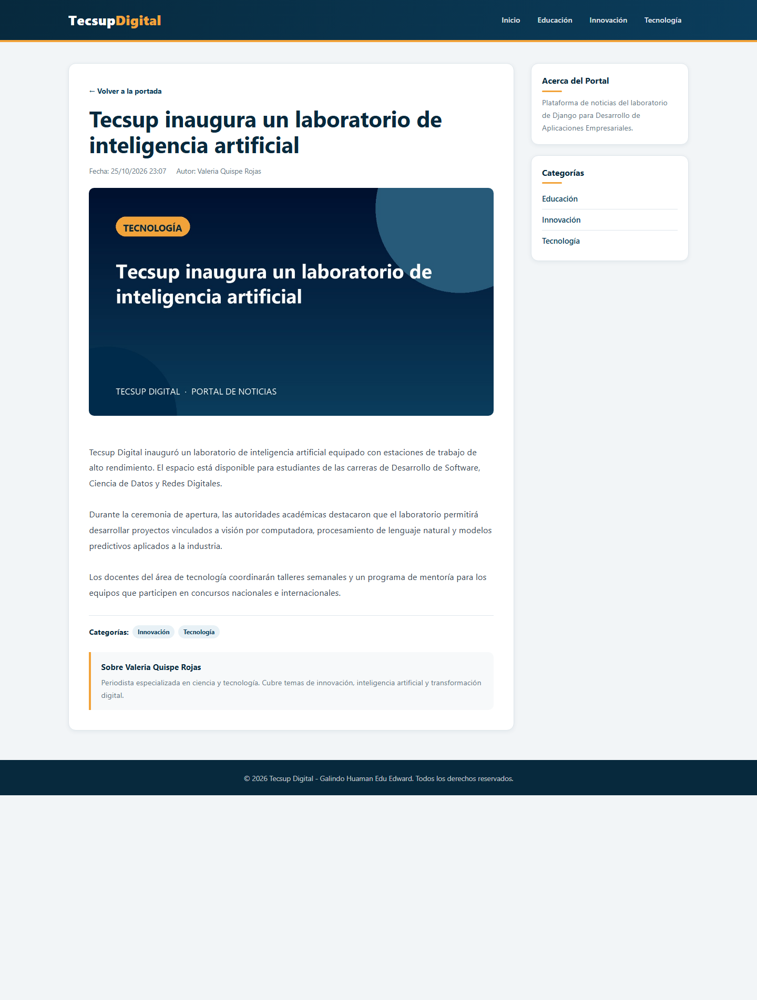
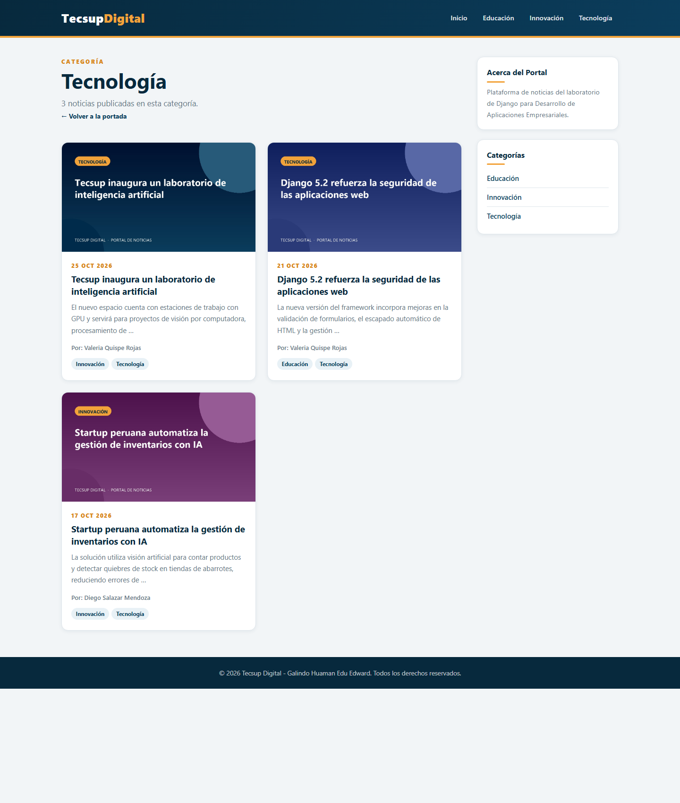
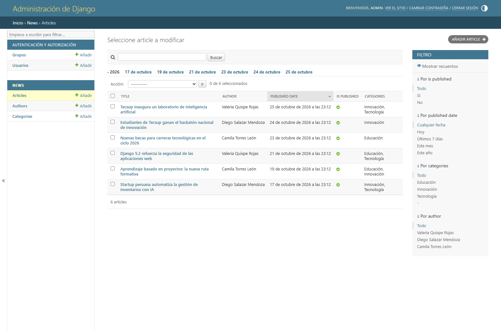
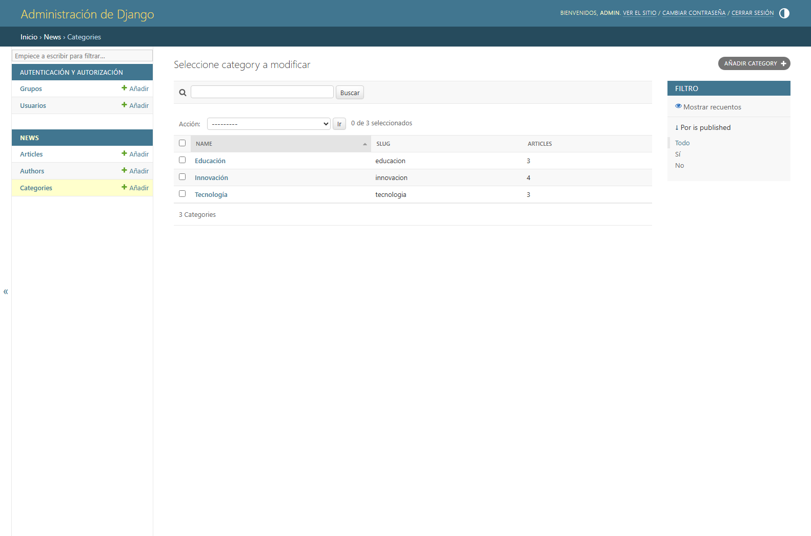
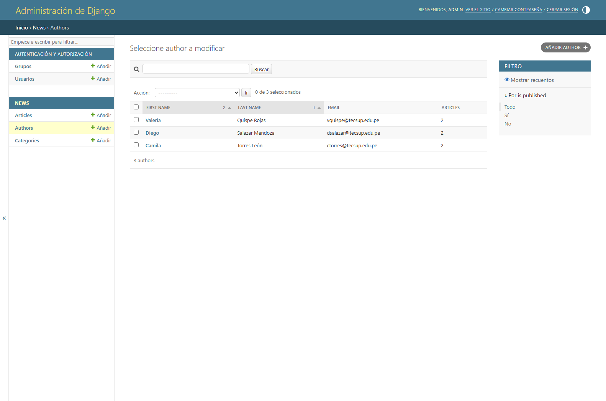
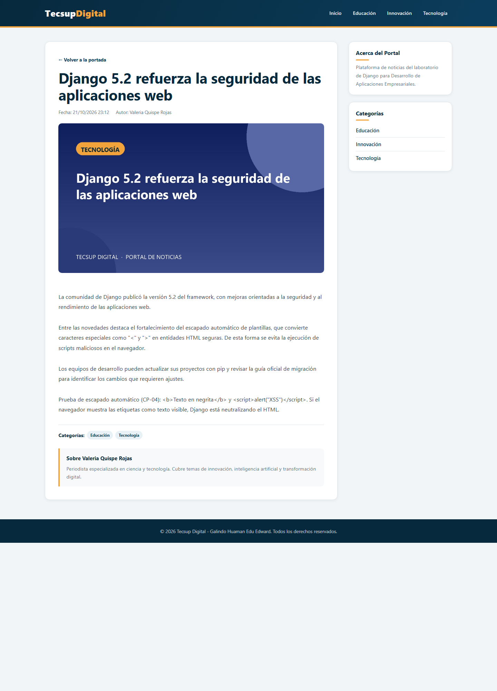

# Informe de Laboratorio N° 06

## Motor de Plantillas con Django: Herencia, Componentes y Gestión de Contenido

| Dato | Valor |
| --- | --- |
| Estudiante | Galindo Huaman Edu Edward |
| Curso | Desarrollo de Aplicaciones Empresariales (4-C24-A) |
| Sección / Grupo | 4-C24-A |
| Fecha de ejecución | Semana 06 - Ciclo 2026-02 |
| Proyecto | `news_portal` |

---

## 1. Capacidades y normas de desarrollo

En esta sesión se implementaron las siguientes capacidades técnicas:

- **Motor de plantillas:** arquitectura modular con herencia
  (``) y fragmentos reutilizables (``).
- **Renderizado dinámico:** variables (`{{ article.title }}`), etiquetas de
  control (``, ``, ``) y filtros (`date`,
  `truncatewords`).
- **Gestión de contenido:** administración de categorías, autores y noticias
  desde Django Admin, sin modificar el código fuente.
- **Seguridad:** verificación del auto-escapado de HTML como protección contra
  XSS.
- **Estándares:** código Python en inglés, PEP 8, y documentación en español.

---

## 2. Estructura del proyecto

```text
news_portal/
├── config/
│   ├── __init__.py
│   ├── settings.py
│   ├── urls.py
│   └── wsgi.py
├── news/
│   ├── management/commands/seed_demo.py
│   ├── migrations/0001_initial.py
│   ├── __init__.py
│   ├── admin.py
│   ├── apps.py
│   ├── models.py
│   ├── tests.py
│   ├── urls.py
│   └── views.py
├── media/
│   ├── articles/
│   └── authors/
├── static/css/styles.css
├── templates/
│   ├── base.html
│   └── news/
│       ├── _article_card.html
│       ├── article_detail.html
│       ├── category_list.html
│       └── home.html
├── docs/capturas/
├── manage.py
├── requirements.txt
└── README.md
```

**Figura 1.** Estructura del proyecto.



**Figura 2.** Portada del portal con las seis noticias y la barra lateral.

---

## 3. Desarrollo del procedimiento paso a paso

### Pasos 1 y 2: proyecto, aplicación y archivos estáticos/medios

Se creó el proyecto Django con `django-admin startproject config .` y la
aplicación con `python manage.py startapp news`. Se instaló Pillow y se
registró `news.apps.NewsConfig` en `INSTALLED_APPS`.

```python
# config/settings.py
INSTALLED_APPS = [
    'django.contrib.admin',
    'django.contrib.auth',
    'django.contrib.contenttypes',
    'django.contrib.sessions',
    'django.contrib.messages',
    'django.contrib.staticfiles',
    # Local apps
    'news.apps.NewsConfig',
]

TEMPLATES = [
    {
        'BACKEND': 'django.template.backends.django.DjangoTemplates',
        'DIRS': [BASE_DIR / 'templates'],
        'APP_DIRS': True,
        'OPTIONS': {
            'context_processors': [
                'django.template.context_processors.request',
                'django.contrib.auth.context_processors.auth',
                'django.contrib.messages.context_processors.messages',
            ],
        },
    },
]

STATIC_URL = 'static/'
STATICFILES_DIRS = [BASE_DIR / 'static']

MEDIA_URL = '/media/'
MEDIA_ROOT = BASE_DIR / 'media'
```

```python
# config/urls.py
from django.conf import settings
from django.conf.urls.static import static
from django.contrib import admin
from django.urls import include, path

urlpatterns = [
    path('admin/', admin.site.urls),
    path('', include('news.urls', namespace='news')),
]

if settings.DEBUG:
    urlpatterns += static(
        settings.MEDIA_URL,
        document_root=settings.MEDIA_ROOT,
    )
```

### Paso 3: modelos, migraciones y superusuario

Se declararon los modelos `Category`, `Author` y `Article` con imagen
destacada, fecha de publicación y relaciones FK/M2M.

```python
# news/models.py (extracto)
class Category(models.Model):
    name = models.CharField(max_length=100, unique=True)
    slug = models.SlugField(max_length=100, unique=True)

    class Meta:
        ordering = ('name',)
        verbose_name_plural = 'Categories'

    def __str__(self):
        return self.name


class Author(models.Model):
    first_name = models.CharField(max_length=100)
    last_name = models.CharField(max_length=100)
    email = models.EmailField(unique=True)
    bio = models.TextField(blank=True)
    profile_picture = models.ImageField(
        upload_to='authors/', blank=True, null=True
    )

    def __str__(self):
        return f'{self.first_name} {self.last_name}'


class Article(models.Model):
    title = models.CharField(max_length=200)
    slug = models.SlugField(max_length=200, unique=True)
    summary = models.TextField(help_text='Brief description for news cards')
    content = models.TextField()
    featured_image = models.ImageField(upload_to='articles/')
    published_date = models.DateTimeField(auto_now_add=True)
    is_published = models.BooleanField(default=True)

    author = models.ForeignKey(
        Author, on_delete=models.CASCADE, related_name='articles'
    )
    categories = models.ManyToManyField(Category, related_name='articles')

    class Meta:
        ordering = ('-published_date',)

    def __str__(self):
        return self.title
```

Comandos ejecutados:

```powershell
python manage.py makemigrations news
python manage.py migrate
$env:DJANGO_SUPERUSER_PASSWORD='Admin12345!'
python manage.py createsuperuser --noinput `
    --username admin --email admin@tecsup.edu.pe
```

### Paso 4: plantilla base con bloques

`templates/base.html` define la estructura común, carga la hoja de estilos con
`` y expone los bloques `title`, `content` y `sidebar`.

```django

<!DOCTYPE html>
<html lang="es">
<head>
    <meta charset="UTF-8">
    <meta name="viewport" content="width=device-width, initial-scale=1.0">
    <title>Tecsup News Portal</title>
    <link rel="stylesheet" href="">
</head>
<body>
    <header class="navbar">
        <div class="container navbar-inner">
            <a href="" class="logo">
                Tecsup<span>Digital</span>
            </a>
            <nav class="main-nav">
                <a href="">Inicio</a>
                
                    <a href="">
                        {{ category.name }}
                    </a>
                
            </nav>
        </div>
    </header>

    <main class="container layout">
        <section class="main-content">
            
        </section>
        <aside class="sidebar">
            ...
        </aside>
    </main>

    <footer>...</footer>
</body>
</html>
```

### Paso 5: fragmento reutilizable `_article_card.html`

```django
<article class="article-card">
    
        <a href="">
            
        </a>
    
    <div class="card-body">
        <time class="card-date"
              datetime="{{ article.published_date|date:'c' }}">
            {{ article.published_date|date:"d M Y" }}
        </time>
        <h3 class="card-title">
            <a href="">
                {{ article.title }}
            </a>
        </h3>
        <p class="card-summary">{{ article.summary|truncatewords:20 }}</p>
        <div class="card-meta">Por: {{ article.author }}</div>
        <div class="card-categories">
            
                <a href=""
                   class="badge">{{ category.name }}</a>
            
        </div>
    </div>
</article>
```

El fragmento se incluye desde la portada y desde el listado por categoría:

```django

```

### Pasos 6, 7 y 8: portada, detalle y categoría

```django
{# templates/news/home.html #}

Portada - Portal de Noticias


    <h1>Últimas Noticias</h1>
    <div class="articles-grid">
        
            
        
            <p class="no-results">
                No hay noticias publicadas en este momento.
            </p>
        
    </div>

```

**Figura 3.** Estado vacío renderizado con ``.



```django
{# templates/news/article_detail.html (extracto) #}

{{ article.title }} - Tecsup News


    <article class="article-detail">
        <h1>{{ article.title }}</h1>
        <div class="meta-bar">
            <span>Fecha: {{ article.published_date|date:"d/m/Y H:i" }}</span>
            <span>Autor: {{ article.author }}</span>
        </div>
        
            
        
        <div class="article-body">{{ article.content }}</div>
        <div class="categories-tag">
            
                <a href=""
                   class="badge">{{ cat.name }}</a>
            
        </div>
    </article>

```

**Figura 4.** Detalle de noticia con imagen destacada, autor y categorías.



```django
{# templates/news/category_list.html (extracto) #}

{{ category.name }} - Portal de Noticias


    <h1>{{ category.name }}</h1>
    <div class="articles-grid">
        
            
        
            <p class="no-results">
                No hay noticias publicadas en esta categoría.
            </p>
        
    </div>

```

**Figura 5.** Listado por categoría reutilizando la misma tarjeta.



### Pasos 9 y 10: rutas nombradas, vistas y estilos

```python
# news/views.py (extracto)
def home_view(request):
    articles = Article.objects.filter(is_published=True).select_related(
        'author'
    ).prefetch_related('categories')
    return render(
        request,
        'news/home.html',
        {'articles': articles, 'categories': Category.objects.all()},
    )


def article_detail_view(request, slug):
    article = get_object_or_404(
        Article.objects.select_related('author').prefetch_related('categories'),
        slug=slug,
        is_published=True,
    )
    return render(
        request,
        'news/article_detail.html',
        {'article': article, 'categories': Category.objects.all()},
    )


def category_list_view(request, slug):
    category = get_object_or_404(Category, slug=slug)
    articles = category.articles.filter(is_published=True).select_related(
        'author'
    ).prefetch_related('categories')
    return render(
        request,
        'news/category_list.html',
        {
            'category': category,
            'articles': articles,
            'categories': Category.objects.all(),
        },
    )
```

```python
# news/urls.py
from django.urls import path
from . import views

app_name = 'news'

urlpatterns = [
    path('', views.home_view, name='home'),
    path(
        'article/<slug:slug>/',
        views.article_detail_view,
        name='article_detail',
    ),
    path(
        'category/<slug:slug>/',
        views.category_list_view,
        name='category_articles',
    ),
]
```

Todos los enlaces se generan con ``; no se escribieron rutas a mano
en las plantillas. La hoja de estilos se carga con
``.

Verificación HTTP:

| Recurso | HTTP | Content-Type |
| --- | --- | --- |
| `/` | 200 | `text/html; charset=utf-8` |
| `/article/<slug>/` | 200 | `text/html; charset=utf-8` |
| `/category/<slug>/` | 200 | `text/html; charset=utf-8` |
| `/static/css/styles.css` | 200 | `text/css` |
| `/media/articles/<archivo>.jpg` | 200 | `image/jpeg` |

### Paso 11: administración personalizada y datos de demostración

```python
# news/admin.py (extracto)
@admin.register(Category)
class CategoryAdmin(admin.ModelAdmin):
    list_display = ('name', 'slug', 'article_count')
    list_filter = (('articles__is_published', admin.BooleanFieldListFilter),)
    search_fields = ('name', 'slug')
    prepopulated_fields = {'slug': ('name',)}


@admin.register(Author)
class AuthorAdmin(admin.ModelAdmin):
    list_display = ('first_name', 'last_name', 'email', 'article_count')
    list_filter = (('articles__is_published', admin.BooleanFieldListFilter),)
    search_fields = ('first_name', 'last_name', 'email', 'bio')


@admin.register(Article)
class ArticleAdmin(admin.ModelAdmin):
    list_display = (
        'title', 'author', 'published_date', 'is_published', 'category_list',
    )
    list_filter = ('is_published', 'published_date', 'categories', 'author')
    search_fields = ('title', 'summary', 'content', 'author__last_name')
    prepopulated_fields = {'slug': ('title',)}
    filter_horizontal = ('categories',)
    date_hierarchy = 'published_date'
```

**Figura 6.** Admin de artículos con columnas, filtros laterales y búsqueda.



**Figura 7.** Admin de categorías con conteo de artículos.



**Figura 8.** Admin de autores con conteo de artículos.



Se cargaron **seis noticias** distribuidas en **tres categorías**
(Tecnología, Educación e Innovación), con tres autores. Las imágenes
destacadas y los perfiles se generaron con Pillow mediante el comando
`python manage.py seed_demo`.

### Paso 12: escapado automático de HTML

Se almacenó en el cuerpo de la noticia *"Django 5.2 refuerza la seguridad de
las aplicaciones web"* el siguiente contenido:

```html
<b>Texto en negrita</b>
<script>alert("XSS")</script>
```

La plantilla lo renderiza con `{{ article.content }}` sin `|safe`. Django
convierte los caracteres especiales en entidades HTML: `<` → `&lt;`,
`>` → `&gt;` y `"` → `&quot;`. El navegador muestra las etiquetas como texto
visible y **no ejecuta** el script.

**Figura 9.** Etiquetas HTML y script mostrados literalmente por el auto-escapado.



**Explicación técnica:** Django activa el auto-escapado por defecto en el motor
de plantillas. Al interpolar una variable, los caracteres con significado HTML
se codifican antes de enviar la respuesta. Esto neutraliza intentos de
inyección de código (XSS). Para renderizar HTML confiable sería necesario
sanearlo y usar explícitamente `|safe` o ``; no se
recomienda para contenido ingresado por usuarios.

### Paso 13: repositorio y entregable

El proyecto se organiza con control de versiones Git. El entregable incluye:

- Código fuente completo del proyecto.
- Este informe en Markdown y en formato DOCX.
- Ocho capturas de pantalla en `docs/capturas/`.
- Diez pruebas automatizadas en `news/tests.py`.
- Comando `seed_demo` para reproducir los datos y las imágenes.

La publicación en el repositorio del equipo y la carga al campus virtual se
realizan con las credenciales institucionales del estudiante.

---

## 4. Matriz de casos de prueba

| ID | Caso de prueba | Entrada / acción | Resultado esperado | Estado |
| --- | --- | --- | --- | --- |
| CP-01 | Herencia de plantillas | Navegar entre portada y detalle | La estructura común se mantiene sin duplicar HTML | PASÓ |
| CP-02 | Reutilización de fragmentos | Cargar portada y categoría | Ambas renderizan `_article_card.html` | PASÓ |
| CP-03 | Gestión desde el admin | Modificar el título de una noticia | El cambio se refleja de inmediato en el portal | PASÓ |
| CP-04 | Escapado HTML | Guardar `<b>` y `<script>` en el contenido | Se muestran como texto escapado; no se ejecuta XSS | PASÓ |
| CP-05 | Estado vacío | Despublicar todas las noticias | Se muestra el bloque `` | PASÓ |
| CP-06 | Filtros de plantilla | Consultar la portada | Fecha con `date` y resumen con `truncatewords` | PASÓ |
| CP-07 | Rutas nombradas | Revertir `news:home`, `news:article_detail`, `news:category_articles` | URLs correctas | PASÓ |
| CP-08 | Archivos estáticos | Buscar `css/styles.css` | Archivo encontrado y servido con HTTP 200 | PASÓ |
| CP-09 | Noticia no publicada | Abrir su detalle | Respuesta HTTP 404 | PASÓ |
| CP-10 | Relaciones en el detalle | Abrir una noticia | Se muestran imagen, autor y categorías | PASÓ |

Salida de las pruebas:

```text
Found 10 test(s).
..........
----------------------------------------------------------------------
Ran 10 tests

OK
```

---

## 5. Autoevaluación según la rúbrica del curso (20 puntos)

| Criterio | Implementación lograda | Nivel | Puntaje |
| --- | --- | --- | --- |
| 1. Herencia y fragmentos reutilizables | `base.html` con bloques y `_article_card.html` reutilizado sin duplicación | Excelente | 5 / 5 |
| 2. Variables, etiquetas y filtros | ``, ``, `date` y `truncatewords` aplicados en plantillas | Excelente | 5 / 5 |
| 3. Gestión de contenido desde el admin | CRUD de noticias, autores y categorías con personalización del panel | Excelente | 5 / 5 |
| 4. Entregable y repositorio | Estructura documentada, código en inglés, capturas y pruebas | Excelente | 5 / 5 |

---

## 6. Conclusiones técnicas

1. La herencia con `` mantiene un diseño homogéneo y
   evita duplicar el marcado; un cambio en la base se propaga a todas las
   páginas.
2. Los fragmentos con `` permiten reutilizar la tarjeta de noticia
   en la portada y en los listados por categoría, reduciendo inconsistencias.
3. La separación entre modelos, vistas y plantillas mantiene la lógica de
   negocio fuera de la capa de presentación; las plantillas solo recorren,
   filtran y formatean datos.
4. El auto-escapado de Django neutraliza HTML y scripts no confiables y
   constituye una defensa esencial contra XSS.
5. El comando `seed_demo` hace reproducible la demostración: genera imágenes
   con Pillow, crea las categorías, autores y noticias, y permite repetir la
   práctica desde cero.
